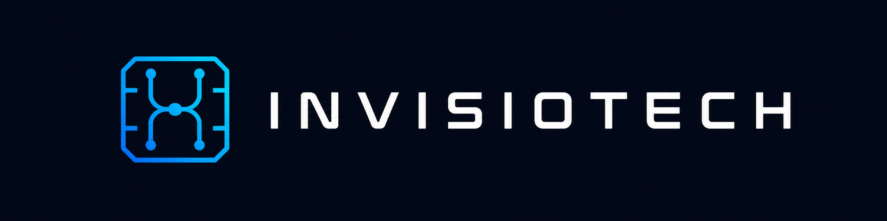

  

  <h1>Mastering the Unseen</h1>

  

    Building an engineering ecosystem across software, original electronics,
    and industrial technologies.
  

  

    
  

  

    
    
    
    
  

---

## Where disciplines connect

Great engineering is more than a collection of files and components. It is a
coherent process — from the first idea to a design that can be documented,
tested, improved, and built.

**Invisiotech** is working toward a connected technology ecosystem that brings
engineering workflows, hardware development, and practical applications together.

## Our three pillars

<table>
  <tr>
    <th width="33%">01 / CORE</th>
    <th width="33%">02 / ORIGINALS</th>
    <th width="34%">03 / INDUSTRIAL</th>
  </tr>
  <tr>
    <td><strong>Engineering software</strong></td>
    <td><strong>Original hardware</strong></td>
    <td><strong>Industrial solutions</strong></td>
  </tr>
  <tr>
    <td>Project integrity, rule-based validation, structured development, and AI-assisted engineering workflows.</td>
    <td>Electronic boards, embedded systems, prototyping tools, and education-oriented hardware.</td>
    <td>Our long-term direction for application-driven engineering, automation, and tailored technology systems.</td>
  </tr>
</table>

## What drives us

- **Integrity:** Engineering decisions should remain traceable across disciplines.
- **Verification:** A useful result should be backed by clear requirements and real tests.
- **Originality:** Develop technology and know-how, not only assemble existing tools.
- **Accessibility:** Make technical knowledge and tools easier to use and understand.

## Connect

  <strong>Mastering the Unseen</strong> 
  <a href="https://invisiotech.tr">invisiotech.tr</a>

Invisiotech · Engineering • Electronics • Technology

