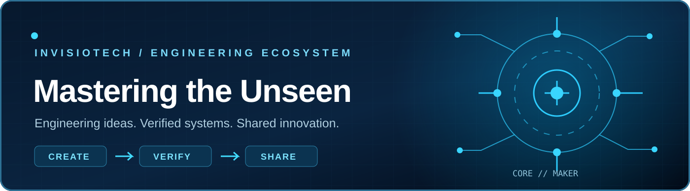
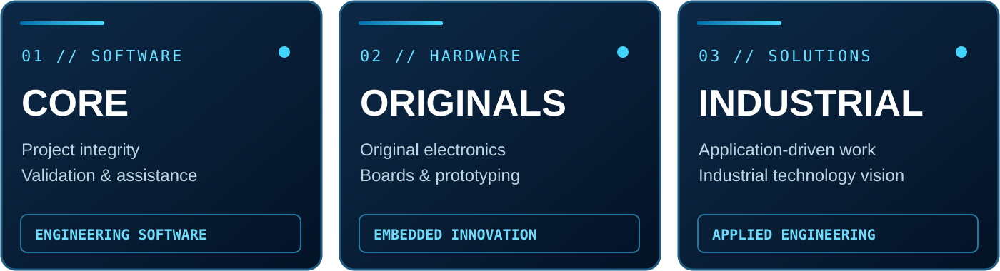
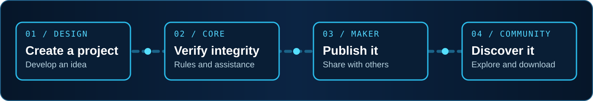

  

  

  

    
    
    
  

  
<strong>SOFTWARE &nbsp;·&nbsp; ELECTRONICS &nbsp;·&nbsp; INDUSTRIAL TECHNOLOGY</strong>

---

<h2 align="center">One vision. Multiple disciplines.</h2>

  From the first engineering concept to validation, prototyping and project sharing, 
  <strong>Invisiotech</strong> is building a connected ecosystem for people who design what comes next.

  

### Beyond the tools — a space to create and discover

<table>
  <tr>
    <td width="50%" valign="top">
      <h3>◈ Invisiotech Core</h3>
      
<strong>Engineering validation and assistance</strong>

      
Build with more clarity. Core focuses on rule-based project verification, interdisciplinary consistency, and AI-assisted workflows.

    </td>
    <td width="50%" valign="top">
      <h3>◇ Invisiotech Maker</h3>
      
<strong>Publish · Discover · Download</strong>

      
A place for makers and engineers to publish their projects, explore shared work, and download projects from the community.

    </td>
  </tr>
  <tr>
    <td width="50%" valign="top">
      <h3>⬡ Invisiotech Originals</h3>
      
<strong>Original electronics and hardware</strong>

      
Our direction for original electronic boards, embedded systems, prototyping hardware, and product-centered documentation.

    </td>
    <td width="50%" valign="top">
      <h3>⌁ Invisiotech Knowledge</h3>
      
<strong>Structured technical learning · Planned</strong>

      
A dedicated knowledge library is on the roadmap. It will be developed as part of the Invisiotech platform, separate from GitHub.

    </td>
  </tr>
</table>

<h2 align="center">From idea to impact</h2>

A simple direction for the experience we are building:

  

### How we think about engineering

| Principle | What it means to us |
| :--- | :--- |
| **Integrity** | Decisions, requirements and components should stay connected across disciplines. |
| **Verification** | Projects benefit from testable rules, clear assumptions and actionable feedback. |
| **Originality** | Engineering means building original capability and understanding the technology beneath it. |
| **Accessibility** | Learning resources, reusable projects and practical tools should be easier to reach. |

---

  <h2>Let's engineer what isn't visible yet.</h2>

  
Explore the ecosystem, discover projects and follow what's taking shape.

  

  
INVISIOTECH &nbsp;•&nbsp; MASTERING THE UNSEEN

